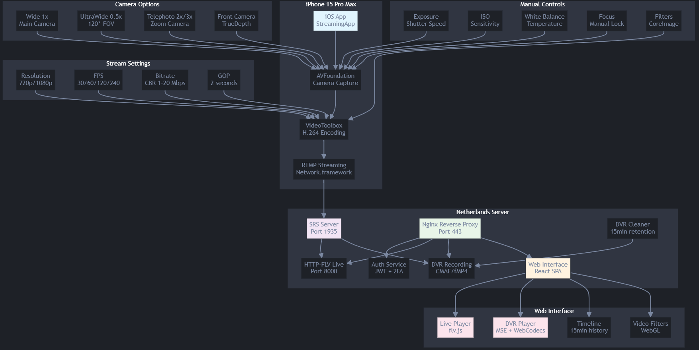

# iOS Streaming Solution (App + RTMP nginx + Web Interface)

Полное решение для потокового видео с iPhone на сервер и мониторинга через веб-интерфейс.

## 🏗️ Архитектура

```
iPhone 15 Pro Max → RTMP → SRS Server → HTTP-FLV/DVR → Web Interface
                              ↓
                         Nginx (Proxy/Auth)
                              ↓
                         Auth Service (2FA)
```

## 📱 Компоненты

### 1. iOS-приложение (StreamingApp)
- **Захват видео**: AVFoundation с поддержкой всех камер iPhone 15 Pro Max
- **Кодирование**: VideoToolbox H.264 High Profile, без B-frames
- **Стриминг**: RTMP с поддержкой работы в фоне
- **Настройки**: Ручное управление камерой, фильтры, выбор разрешения/FPS

### 2. Сервер
- **SRS**: RTMP ingest, HTTP-FLV live, DVR запись
- **Nginx**: Reverse proxy, TLS, авторизация
- **Auth Service**: JWT + 2FA (TOTP)
- **DVR Cleaner**: Автоматическая очистка старых записей

### 3. Веб-интерфейс
- **Live Player**: HTTP-FLV через flv.js, минимальная задержка
- **DVR Player**: MSE + WebCodecs, покадровый просмотр
- **Timeline**: 15-минутный таймлайн с навигацией
- **Фильтры**: Локальные WebGL фильтры

## 🚀 Быстрый старт

### Предварительные требования

- Docker и Docker Compose
- Домен с SSL сертификатом
- iPhone 15 Pro Max с iOS 17+
- Xcode 15+ (для сборки iOS-приложения)

### 1. Настройка сервера

```bash
# Клонируем проект
git clone [<repository-url>](https://github.com/gr33njj/iOS-Streaming-Solution-App-RTMP-nginx-Web-Interface-.git)
cd streaming-solution/server

# Настраиваем переменные окружения
cp .env.example .env
# Отредактируйте .env файл с вашими настройками

# Настраиваем SSL сертификаты
mkdir -p ssl
# Скопируйте cert.pem и key.pem в папку ssl/

# Запускаем сервисы
docker-compose up -d

# Проверяем статус
docker-compose ps
```

### 2. Сборка iOS-приложения

```bash
cd streaming-solution/ios-app
# Откройте StreamingApp.xcodeproj в Xcode
# Настройте Bundle Identifier и подписание
# Соберите и установите на iPhone 15 Pro Max
```

### 3. Настройка веб-интерфейса

```bash
cd streaming-solution/web-interface

# Устанавливаем зависимости
npm install

# Для разработки
npm run dev

# Для production
npm run build
# Скопируйте dist/ в server/web/
```

## ⚙️ Конфигурация

### iOS-приложение

Основные настройки в приложении:

1. **RTMP URL**: `rtmp://your-domain.com/live/streamkey`
2. **Разрешение**: 720p/1080p
3. **FPS**: 30/60/120/240 (зависит от камеры)
4. **Камера**: Wide/UltraWide/Telephoto
5. **Качество**: Ручные настройки экспозиции, ISO, баланса белого

### Веб-интерфейс

Доступ: `https://your-domain.com`

Учетные данные по умолчанию:
- **Username**: `admin`
- **Password**: `admin123`
- **2FA**: Настраивается при первом входе

## 📖 Использование

### Запуск стрима с iPhone

1. Откройте приложение StreamingApp
2. Введите RTMP URL: `rtmp://your-domain.com/live/your-stream-key`
3. Выберите настройки:
   - Разрешение: 1080p (рекомендуется)
   - FPS: 30 (для стабильности) или 60 (для высокого качества)
   - Камера: Wide 1x (по умолчанию)
4. Настройте фильтры если нужно
5. Нажмите "Начать стрим"

### Просмотр в веб-интерфейсе

1. Откройте `https://your-domain.com`
2. Войдите в систему (admin/admin123)
3. Настройте 2FA при первом входе
4. Выберите активный стрим
5. Используйте два плеера:
   - **Live**: Просмотр в реальном времени
   - **DVR**: Просмотр записи с навигацией

### Горячие клавиши

- `←/→` - Покадровая навигация в DVR
- `Space` - Воспроизведение/пауза DVR
- `L` - Переход к live
- `Ctrl+1/2/3` - Переключение режимов отображения
- `Ctrl+H` - Скрыть/показать панели управления

## 🔧 Техническая информация

### Параметры кодирования

**Видео (H.264)**:
- Профиль: High Profile
- GOP: 2 секунды (keyint = fps * 2)
- B-frames: Отключены (zerolatency)
- Битрейт: CBR, 5 Mbps по умолчанию
- Разрешения: 720p (1280x720), 1080p (1920x1080)

**Аудио (AAC)**:
- Кодек: AAC LC
- Частота: 48 kHz
- Каналы: Стерео

### Задержка

- **RTMP → SRS**: ~500ms
- **SRS → HTTP-FLV**: ~2-4 секунды
- **Общая задержка**: 2.5-4.5 секунды

### DVR

- **Формат**: CMAF/fMP4
- **Длительность сегмента**: 1 секунда
- **Retention**: 15 минут (настраивается)
- **Автоочистка**: Каждые 30 секунд

## 🔒 Безопасность

### Авторизация

- JWT токены с 24-часовым TTL
- Двухфакторная аутентификация (TOTP)
- Rate limiting на API endpoints
- Защищенные cookie с httpOnly

### HTTPS

- TLS 1.2/1.3
- HSTS заголовки
- Защита от XSS и CSRF
- Content Security Policy

## 📄 Лицензия

MIT License - см. файл LICENSE для деталей.


